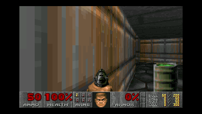
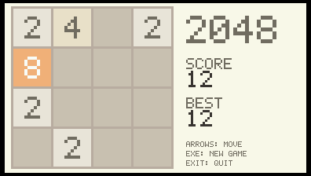
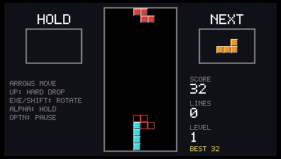
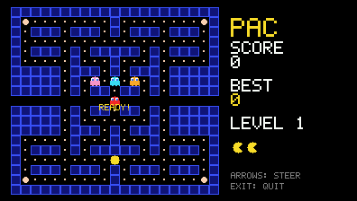
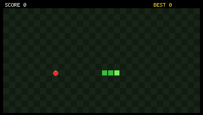
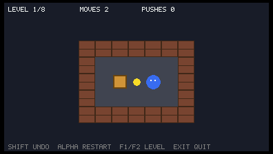
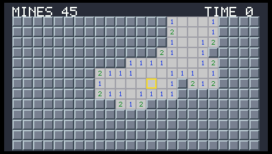
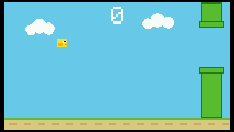
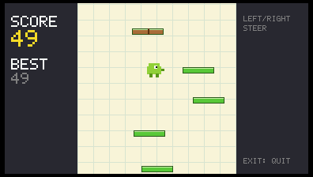

# fx-CG50 Games

Games for the **Casio fx-CG50** (also sold as the Graph 90+E): a graphing
calculator with a 384x216 color screen and a 118 MHz processor.

This repo contains:

| Game | What it is | Folder |
|---|---|---|
| **Doom** | The 1993 shooter, ported from the open-source engine | [`games/doom`](games/doom) |
| **2048** | Slide and merge number tiles | [`games/arcade/g2048`](games/arcade/g2048) |
| **Tetris** | Falling blocks, with hold, ghost piece and levels | [`games/arcade/tetris`](games/arcade/tetris) |
| **Snake** | Eat, grow, don't crash | [`games/arcade/snake`](games/arcade/snake) |
| **Pac-Man** | Maze chase with four ghosts and power pellets | [`games/arcade/pacman`](games/arcade/pacman) |
| **Sokoban** | Push boxes onto goals (8 levels, all proven solvable) | [`games/arcade/sokoban`](games/arcade/sokoban) |
| **Minesweeper** | 24x13 board, 45 mines, safe first click | [`games/arcade/mines`](games/arcade/mines) |
| **Flappy Bird** | Tap to flap through the pipes | [`games/arcade/flappy`](games/arcade/flappy) |
| **Doodle Jump** | Bounce up forever | [`games/arcade/doodle`](games/arcade/doodle) |

Ideas that are planned but not built yet live in [`todo/`](todo/).

## Screenshots

These are rendered on a desktop by the test harness, using the same drawing
code as the calculator build.

| | | |
|---|---|---|
|  |  |  |
|  |  |  |
|  |  |  |

## Important: honest status

**This code was written without access to a calculator or to the fxSDK.**
Everything has been built and run on a Mac against *stand-in* (stub) versions of
the calculator's library, which is how the screenshots above were made. That
proves the game logic, drawing and engine start-up work. It does **not** prove
that the real hardware libraries behave as I remembered, so expect to fix a
few small compile errors or API-name differences on your first real build.
If you try it, please open an issue with what happened. The most likely trouble
spots are listed in [`games/doom/README.md`](games/doom/README.md).

## How to put a game on your calculator

You need three things: a computer, a USB cable, and the fx-CG50.

### Step 1: Install the build tools (once)

The games are built with **fxSDK** and **gint**, the community toolkit for
programming Casio calculators. The official installation guide is on
[Planète Casio](https://gitea.planet-casio.fr/Lephenixnoir/fxsdk) (the fxSDK
page). In short, on Linux or macOS:

```sh
pip install giteapc                    # the fxSDK package manager
giteapc install Lephenixnoir/fxsdk     # also pulls in the compiler and gint
giteapc install Lephenixnoir/gint
```

Windows users should use WSL (Windows Subsystem for Linux) and follow the
Linux steps there. When it works, `fxsdk --version` prints a version number.
You also need Python 3 and CMake (both common; install with your package
manager).

### Step 2: Build

Open a terminal in the game's folder and run `fxsdk build-cg`.

```sh
git clone <this repository>
cd fx-CG50-games

# the 8 small games: builds all of them at once
cd games/arcade
fxsdk build-cg
ls build-cg/*.g3a        # 2048.g3a  Tetris.g3a  Snake.g3a  PacMan.g3a ...

# Doom (separate project)
cd ../doom
fxsdk build-cg           # produces build-cg/Doom.g3a
```

A `.g3a` file is a calculator program ("add-in").

### Step 3: Copy to the calculator

1. Connect the calculator to your computer with the USB cable.
2. On the calculator, a "Connect as" dialog appears. Choose **USB Flash**
   (mass storage). If it does not appear, press `MENU` -> **Link** (the
   exact label depends on your OS version) and choose USB Flash.
3. The calculator shows up as a drive. Copy the `.g3a` files you want to the
   **root** of that drive (not in a subfolder).
4. Safely eject the drive. The new games appear in the calculator's main menu.

Alternative: if you installed fxSDK, `fxlink` can send files from the
command line, see the fxSDK docs.

### Extra step for Doom only: the game data

Doom's artwork and levels live in a "WAD" file that is **not** included here
(it is not covered by this repo's license). The free shareware version works:

1. Get `DOOM1.WAD` (the shareware episode is free to distribute; many
   mirrors host it).
2. Shrink it, since the calculator has no sound:
   `python3 games/doom/tools/wadtrim.py DOOM1.WAD DOOM1.TRIM.WAD`
3. Rename the result to exactly `DOOM1.WAD` and copy it to the calculator's
   root, next to `Doom.g3a`. It is about 3.4 MB, so check free space first.

## Controls

The arrow keys, **EXE**, **SHIFT**, **ALPHA** and **EXIT** are used by every
game. `EXIT` always quits to the calculator menu.

| Game | Controls |
|---|---|
| 2048 | Arrows slide tiles. EXE: new game |
| Tetris | Left/Right move, Down soft drop, **Up hard drop**, EXE rotate, SHIFT rotate back, ALPHA hold, OPTN pause |
| Snake | Arrows steer. EXE: restart |
| Pac-Man | Arrows steer. EXE: restart after game over |
| Sokoban | Arrows move, SHIFT undo, ALPHA restart level, F1/F2 previous/next level, EXE next level when solved |
| Minesweeper | Arrows move, EXE open (or "chord" on a number), SHIFT flag, ALPHA new game |
| Flappy Bird | EXE, Up or SHIFT to flap |
| Doodle Jump | Left/Right steer (you wrap around the edges). EXE: retry |
| Doom | Arrows move, EXE fire, ALPHA use/open, SHIFT run, F1/F2 strafe, 1-7 weapons, F3 map. Full table in [`games/doom/README.md`](games/doom/README.md) |

## Repository layout

```
games/
  arcade/        the 8 small games, one shared build (CMakeLists.txt)
    common/        small toolkit shared by all of them: drawing, text
                   font, keys, timing, random numbers (cgx.c / cgx.h)
    <game>/        <game>.c / .h = the rules (no hardware code)
                   main.c        = drawing and input for the calculator
    tests/         automatic tests for every game's rules
  doom/          the Doom port (engine + calculator-specific layer)
common/
  host/          fake calculator libraries so everything can run on a PC
  tools/         icon generator
docs/screenshots/
todo/            ideas not built yet (Wolf3D-style raycaster, platformer, emulators)
```

The games are deliberately split in two: the **rules** know nothing about the
calculator, so they can be tested on a normal computer; a thin `main.c` adds
the screen and keys. If you want to write your own game, copy a small one such
as [`games/arcade/snake`](games/arcade/snake) and start there.

## Testing without a calculator

You only need a C compiler (and Python 3 for screenshots):

```sh
games/arcade/tests/run_tests.sh        # rules tests + headless run + screenshots
games/doom/tests/host/run_checks.sh /path/to/folder/with/DOOM1.WAD
```

What the tests check, for example: Sokoban levels are solved by a
search program (so none is impossible), Doodle Jump is climbed for two minutes
by a bot that simulates the real physics, Pac-Man's ghosts never walk into
walls over 150,000 simulated steps, and the real Doom engine boots and
plays E1M1 headlessly.

## Credits and licenses

In short: **MIT for the small games and tools, GPL-2.0-or-later for Doom.**

- **Doom** is by id Software. The portable source is
  [doomgeneric](https://github.com/ozkl/doomgeneric) (ozkl), based on
  Chocolate Doom (Simon Howard) and the original Doom source release. It is
  licensed **GPL-2.0-or-later**; see [`games/doom/LICENSE`](games/doom/LICENSE)
  and [`games/doom/LICENSE.doomgeneric`](games/doom/LICENSE.doomgeneric).
  The Doom game data (WAD) is not included and is not covered by that license.
- The calculator toolchain is [fxSDK and gint](https://gitea.planet-casio.fr/Lephenixnoir/fxsdk)
  by Lephenixnoir and the Planète Casio community.
- Everything **outside `games/doom/`** (the 8 small games, the shared toolkit,
  the test harness and tools) is original code under the **MIT License**; see
  [`LICENSE`](LICENSE). It is free to use, change and share, including in
  commercial projects, as long as the copyright notice is kept.
- **`games/doom/` is GPL-2.0-or-later**, because Doom's source is. If you
  distribute a built `Doom.g3a`, you must also make its source available under
  the same terms.
